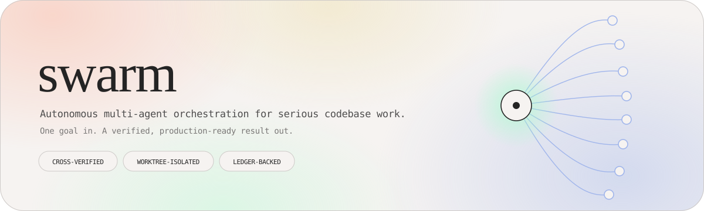
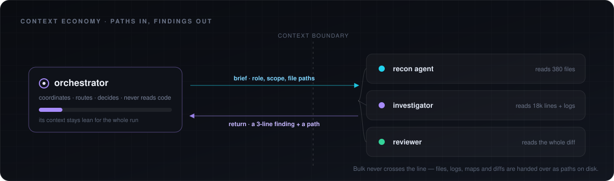
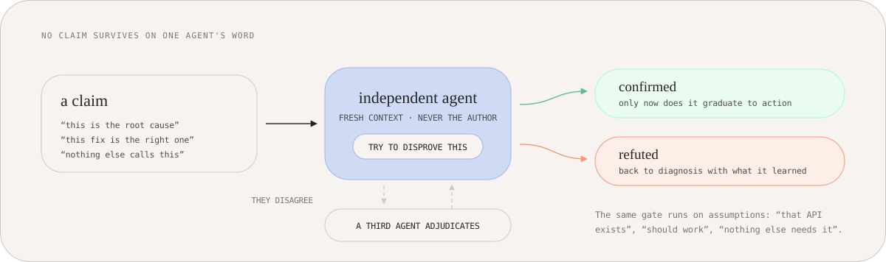
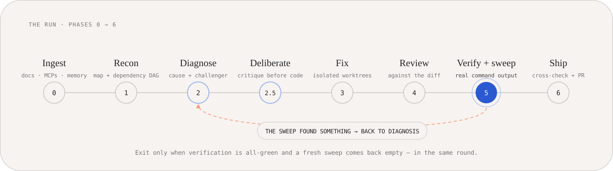
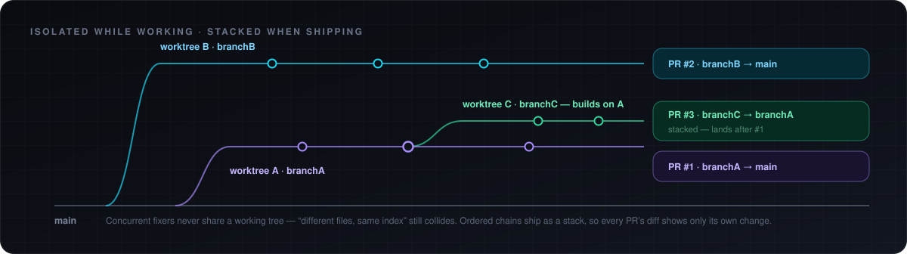

<p align="center">
  
</p>

<p align="center">
  
  
  
  
  
</p>

<p align="center">
  <a href="https://saarthurr.github.io/swarm/"><b>saarthurr.github.io/swarm</b></a>
</p>

# swarm

> **The strongest thing you can do is give an agent a way to review its work.**
> That is what swarm is.

An agent skill that turns a single broad instruction — *"fix the bugs"*, *"figure out why X
isn't working"*, *"make this production-ready"*, *"audit and harden this"* — into an
autonomous, self-verifying run across the whole codebase.

The agent that loads this skill stops being an implementer and becomes an **orchestrator**:
it fans out dozens of isolated sub-agents to explore, diagnose, fix, review, and verify,
cross-checks every conclusion with an independent agent, and does not return until the work
is done and proven — or until it hits a decision only a human can make.

Works in Claude Code, Codex, Cursor, and any agent host that supports skills + parallel sub-agents.

---

## Why

Two problems kill long autonomous runs:

1. **Context burn.** Reading a codebase into the orchestrator's own context spends the
   budget it needs to coordinate. Swarm pushes all reading down into sub-agents that return
   a tight distilled brief; bulk data moves between agents as *files on disk*, never pasted
   text.
2. **Hallucinated confidence.** An agent that checks its own conclusion has checked nothing.
   Every root cause, every fix, every "should work" is handed to an *independent* agent with
   fresh context as a hypothesis to disprove before it graduates to action.

On top of that it keeps a durable ledger, so a run survives compaction and restarts without
re-doing finished work.

**The orchestrator holds paths, not payloads.**

<p align="center">
  
</p>

**No claim survives on one agent's word.**

<p align="center">
  
</p>

## What it actually does

<p align="center">
  
</p>

| Phase | What happens |
|---|---|
| **0 — Context ingestion** | Loads prior per-repo learnings, opens the run ledger, and pulls real state from every named tool/MCP (Supabase schema + advisors + logs, Vercel config/deploys, Render services, Slack threads, official docs) through parallel sub-agents. |
| **1 — Reconnaissance** | One sub-agent per independent area maps the territory to a file. A synthesis agent consolidates them into a ranked problem list plus a **dependency map** of the work — the DAG that drives parallel scheduling and PR stacking. |
| **2 — Diagnosis** | An investigator finds the root cause with evidence (exact code path, failing condition, every caller). A **separate** verifier tries to disprove it. Disagreement → a third adjudicates. Only cross-confirmed causes graduate. |
| **2.5 — Deliberation** | Before any code is written, the proposed fix goes to two or more independent agents to critique: is there a simpler fix, which sibling callers break, is this patching a symptom, is it over-built? |
| **3 — Parallel fixing** | Independent fixes run concurrently, each in its **own git worktree and branch** so they can't corrupt each other. Code is written under the `ponytail` discipline (laziest solution that actually works). Each fixer returns one status: `DONE` / `DONE_WITH_CONCERNS` / `BLOCKED` / `NEEDS_CONTEXT`. |
| **4 — Review gate** | No fix is accepted on the fixer's word. An independent reviewer checks **the diff itself**, not the status line — correctness, root-cause vs symptom, dead/debug code, regressions in siblings. Loops until clean, then one whole-branch review for cross-cutting issues. |
| **5 — Verify, then sweep again** | Real command output only — fresh build, tests, types, lint, plus the task-specific check. Then a *fresh* recon pass hunts what's still broken or newly exposed. The run exits only when verification and a clean sweep both come back empty **in the same round**. A convergence cap stops a flapping fix from burning unbounded cycles. |
| **6 — Cross-check & ship** | Diffs against latest `main` for merge *and semantic* conflicts, enumerates open PRs for collisions, runs a pre-flight safety scan, then opens the PR — **stacking dependent PRs** (`branchB → branchA → main`) instead of pointing a pile of branches at `main`. Durable learnings are appended for the next run. |

### Parallel work, isolated — and stacked on the way out

<p align="center">
  
</p>

Every response ends with a **"What I need from you"** handoff: the secrets it couldn't
supply, actions only a human can take, cost/destructive approvals, the PR links with merge
order, and any collisions found — or an explicit *"nothing needed"*.

## Design principles

- **Finish the job.** No half-answers, no plans to approve, no "here's what I'd do next".
- **Never trust a single source.** One agent's confident answer is a hypothesis.
- **Assume nothing.** "That API exists", "nothing else calls this" — confirm each against
  real code/docs/runtime before acting.
- **Production-ready or not done.** Builds pass, tests pass, types and lint clean, no dead
  code, no leftover debug.
- **Boil the ocean, but stay lazy.** Completeness of the *fix* is non-negotiable;
  speculative layers on top are not the same thing. `ponytail` governs how code gets written.
- **Interrupt almost never.** Money, destructive/irreversible actions, design-critical forks
  the codebase genuinely can't answer, and true hard blockers. Nothing else.

## Layout

```
swarm/
├── SKILL.md                          # the orchestrator: phases 0–6, contract, red flags
├── references/
│   ├── subagent-contracts.md         # dispatch briefs + return contracts per agent role
│   ├── state-and-memory.md           # .swarm/ledger.md and .swarm/learnings.md schemas
│   ├── safety.md                     # standing orders for every writing/shell/git agent
│   └── observability.md              # .swarm/events.jsonl semantic event stream
├── docs/                             # landing page (GitHub Pages) + diagrams
└── DASHBOARD_PRD.md                  # PRD for Swarm Mission Control (companion dashboard)
```

References are loaded on demand, at the phase that needs them — the skill stays cheap until
it's working.

### Safety

Every sub-agent that can write files, run shell, or touch git carries standing orders:
never force-push, never push to `main`, never merge a PR, no destructive shell without an
explicit human gate, no secrets in commits/logs/returns, stay in the assigned scope, and
never provision anything that could cost money. The orchestrator re-enforces them on return.

### Durable state

Two plain-markdown files at the repo root under `.swarm/` (gitignored, never committed):

- `ledger.md` — this run's source of truth: phase, root causes, fixes and their states,
  review verdicts, worktrees/branches. Append-only, so a compacted or restarted session
  resumes instead of re-doing work.
- `learnings.md` — durable per-repo facts carried into future runs.

Plus `events.jsonl`, an append-only semantic event stream (`run.started`, `dag.updated`,
`fix.*`, `review.verdict`, `verification.result`, `sweep.result`, `blocker.raised`,
`pr.opened`) — the machine-readable twin of the ledger, for anything that wants to render a
run live.

## Install

Clone into your skills directory:

```bash
# Cursor
git clone https://github.com/SaarthurR/swarm.git ~/.cursor/skills/swarm

# Claude Code
git clone https://github.com/SaarthurR/swarm.git ~/.claude/skills/swarm

# Codex
git clone https://github.com/SaarthurR/swarm.git ~/.codex/skills/swarm
```

Or clone once and symlink both:

```bash
git clone https://github.com/SaarthurR/swarm.git ~/skills/swarm
ln -s ~/skills/swarm ~/.cursor/skills/swarm
ln -s ~/skills/swarm ~/.claude/skills/swarm
ln -s ~/skills/swarm ~/.codex/skills/swarm
```

## Use

Say `swarm` and hand over the goal:

```
swarm — checkout is dropping orders under load, find out why and fix it properly
swarm this repo: make it production-ready before Friday's launch
swarm — audit and harden the auth layer, use the Supabase MCP for schema and advisors
```

Naming a tool, MCP, or platform ("this is on Vercel", "use Supabase and Slack") is read as an
instruction to fully ingest that source, not a passing mention.

### Model tiers

Sub-agent models are always set explicitly — an omitted model silently inherits the
expensive session model. Three tiers: the brain tier runs the orchestrator and every
agent it discusses with (investigators, critics, reviewers, verifiers); workers only
write code; scouts only read. A worker moves up a tier only after a failed review. The tier table
lives in `SKILL.md`; update it as models change.

## Companion skills

Optional — the skill is self-contained without them, but they sharpen individual phases:

- **ponytail** — the laziest-solution-that-works discipline all code is written under;
  mandatory for fixers.
- **stacked-prs** — the canonical procedure for opening dependent PR stacks (Phase 6).
- **superpowers**: `dispatching-parallel-agents`, `subagent-driven-development`,
  `verification-before-completion`, `systematic-debugging`.

## Swarm Mission Control (planned)

`DASHBOARD_PRD.md` specs a local-first dashboard that reads `.swarm/events.jsonl` and renders
a run live: which agents are alive and what each is thinking, root causes moving from
hypothesis to confirmed/refuted, fixes progressing through proposed → verified, the parallel
work DAG, and actionable cards for the blocking questions and approval gates — plus an input
box to launch and steer runs headlessly. Draft; not built yet.

## License

MIT
